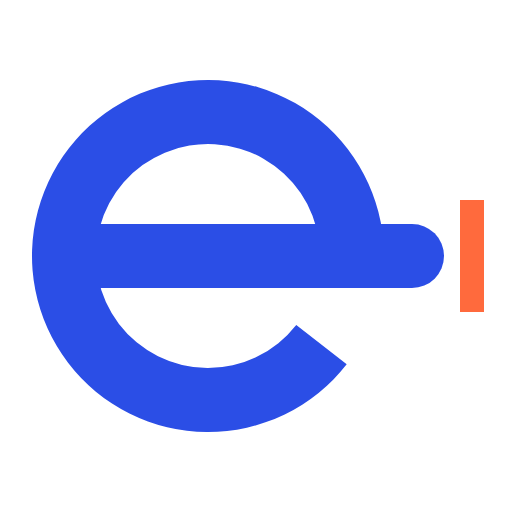

# Brand

## The symbol

A lowercase **e** whose bar runs on past the letter, like a kashida (the stretch in Arabic writing), with a text cursor after it. One stroke for Arabic and English, and a line still being written.



The masters are in `brand/` and are made by `scripts/gen-brand.py`. Never edit the SVGs by hand: change the script and run it again.

```powershell
uv run --no-project --with fonttools python -I scripts/gen-brand.py   # SVG masters, ui/src/logo.ts
npx prettier --write ui/src/logo.ts
python -I scripts/gen-brand-icons.py                                  # ICO and PNG files
npx tauri icon brand/app-icon.png -o <temp folder>                    # then copy icon.icns to src-tauri/icons
```

| File | Use |
|---|---|
| `symbol.svg` | The symbol in colour (cobalt e, coral cursor) |
| `symbol-black.svg`, `symbol-white.svg` | One colour, on light or dark backgrounds |
| `symbol-small.svg`, `symbol-small-black.svg` | 32 px and smaller: heavier strokes, no cursor |
| `app-icon.svg`, `app-icon-small.svg` | The app icon: white symbol on a cobalt tile |
| `pdf-file.svg`, `pdf-file-small.svg` | The icon for PDF files: a page with the symbol and a PDF label (no label at 32 px and smaller) |
| `lockup.svg`, `lockup-white.svg`, `lockup-black.svg` | The symbol with the name beside it |
| `lockup-stacked.svg` | The name under the symbol |

The app icon and the PDF file icon are kept apart on purpose: the app is a tile, files are pages.

## Colours

| Name | HEX | RGB | Use |
|---|---|---|---|
| Cobalt | `#2B4EE6` | 43 78 230 | The symbol, the app tile, the interface accent |
| Cobalt light | `#4466F5` | 68 102 245 | Top of the tile's gradient |
| Cobalt dark | `#1F37C2` | 31 55 194 | Bottom of the tile's gradient |
| Coral | `#FF6A3D` | 255 106 61 | The cursor only, and small accents (PDF badges) |
| Ink | `#141A33` | 20 26 51 | The name, text on light backgrounds |

White on cobalt has a contrast of 6.3:1. Coral is never used for text. In the interface the colours are CSS variables (`--brand`, `--brand-light`, `--brand-dark`, `--brand-cursor` in `ui/src/app.css`).

## Type

The name is IBM Plex Sans Arabic Bold (OFL), turned into outlines, so no font is needed to show it. The same family is the one edits embeds in PDFs, and it covers Arabic for an Arabic name later.

## Use

- **Clear space:** keep the height of the bar (32 units of 256) free on every side.
- **Smallest size:** the symbol at 16 px (small cut); the name beside it at 20 px high.
- **Backgrounds:** colour on white or light grey; white on cobalt or on dark; black or white where only one colour prints.
- **Don't:** turn, stretch or outline the symbol; change the cursor's colour to anything but coral or the symbol's own colour; put the colour symbol on a busy photo; add shadows or effects.

## Notes

- A trademark search has not been done. Do one before relying on the name and symbol commercially.
- Windows shows the PDF file icon only where edits is the default app for PDF files; otherwise Explorer shows the default app's icon.
